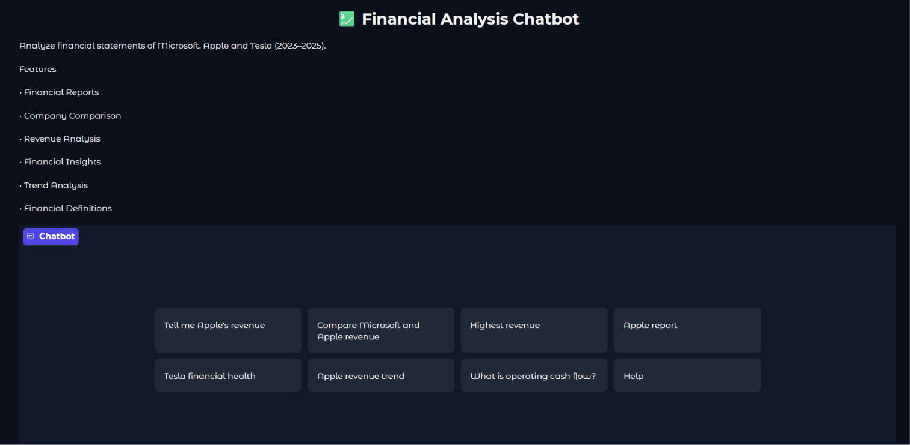
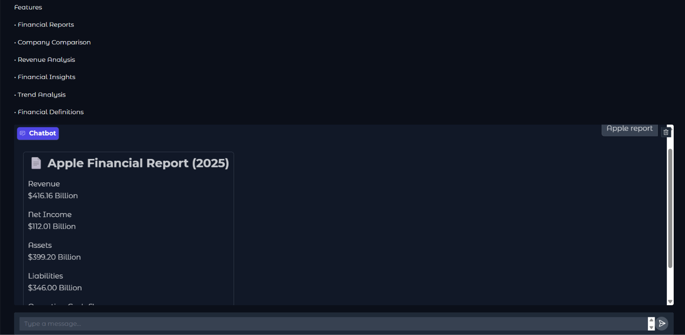
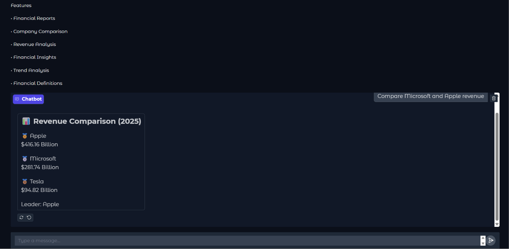
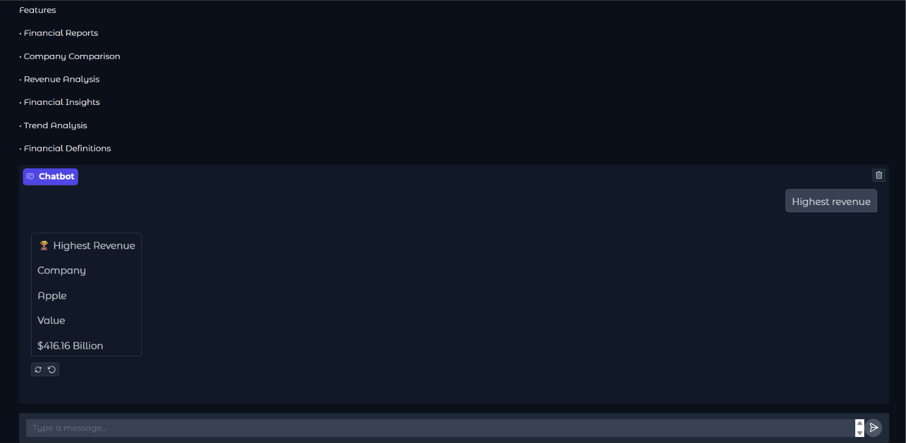
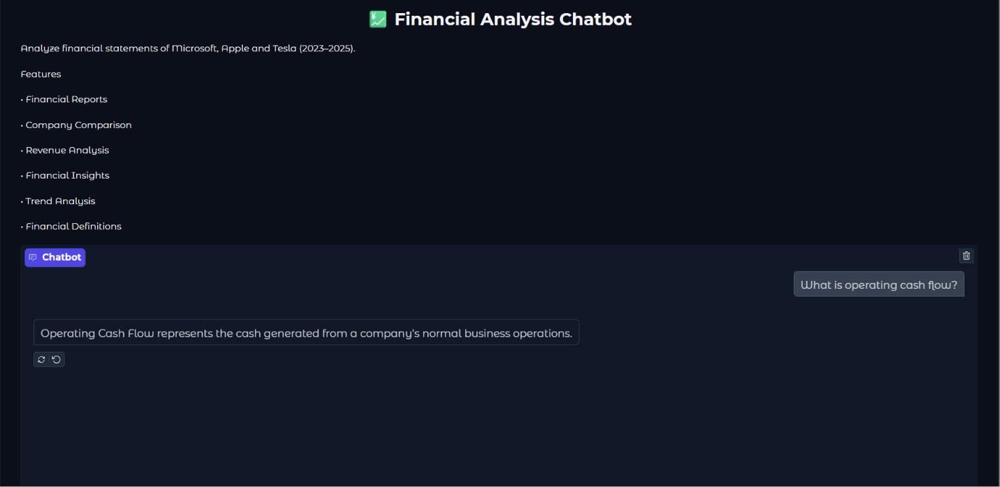

# 💹 Financial Analysis Chatbot

A Python-based financial analysis chatbot that helps users explore company financial data through natural-language queries. It uses **Pandas** for data processing and **Gradio** for an interactive conversational interface.

The chatbot provides financial reports, company comparisons, rankings, and data-driven insights using historical financial data.

---

## 📌 Overview

Understanding financial statements often requires manually examining multiple financial metrics and comparing figures across companies and financial years.

This project simplifies that process by allowing users to interact with financial data through a chatbot interface.

Users can ask questions about company performance and receive structured responses based on the available dataset.

---

## ✨ Features

* **📊 Financial Reports:** Retrieve financial information and performance summaries for individual companies.
* **⚖️ Company Comparison:** Compare the financial performance of multiple companies.
* **🏆 Financial Rankings:** Rank companies based on selected financial metrics.
* **💡 Financial Insights:** Generate rule-based insights from available financial data.
* **💬 Conversational Interface:** Interact with financial information using natural-language queries.
* **📁 Excel Data Processing:** Process structured financial datasets using Pandas.

---

## 🖥️ Application Screenshots

### 1. Home Interface

The main chatbot interface through which users interact with the application.



### 2. Financial Report

View financial information and performance details for a selected company.



### 3. Company Comparison

Compare financial metrics across different companies.



### 4. Financial Rankings

Explore company rankings based on selected financial parameters.



### 5. Financial Definitions

Understand financial terminology through the chatbot.



---

## 🛠️ Tech Stack

| Technology       | Purpose                                |
| ---------------- | -------------------------------------- |
| Python           | Core programming language              |
| Pandas           | Data processing and financial analysis |
| Gradio           | Interactive chatbot interface          |
| FastAPI          | Backend application framework          |
| OpenPyXL         | Reading Excel datasets                 |
| Jupyter Notebook | Development and experimentation        |

---

## 📂 Project Structure

```text
financial-analysis-chatbot/
│
├── app.py
├── Financial_Analysis_Chatbot.ipynb
├── requirements.txt
├── tech_financials_2023_2025.xlsx
├── LICENSE
├── README.md
│
├── home.png
├── report.png
├── comparison.png
├── ranking.png
└── definition.png
```

---

## ⚙️ Installation and Setup

Follow these steps to run the project locally.

### 1. Clone the Repository

```bash
git clone https://github.com/harshsatyarthi-bit/financial-analysis-chatbot.git
```

### 2. Navigate to the Project Directory

```bash
cd financial-analysis-chatbot
```

### 3. Create a Virtual Environment

```bash
python -m venv venv
```

Activate the environment:

**Windows:**

```bash
venv\Scripts\activate
```

**Linux/macOS:**

```bash
source venv/bin/activate
```

### 4. Install Dependencies

```bash
pip install -r requirements.txt
```

### 5. Run the Application

```bash
uvicorn app:app --reload
```

### 6. Open the Application

Visit:

```text
http://127.0.0.1:8000
```

The Gradio interface should be accessible through the browser.

---

## 📈 Dataset

The project uses an Excel dataset:

`tech_financials_2023_2025.xlsx`

The dataset contains historical financial information for technology companies, including:

* Company
* Fiscal Year
* Total Revenue
* Net Income
* Total Assets
* Total Liabilities
* Cash Flow from Operations

The chatbot processes this information to answer queries and perform financial comparisons.

---

## 🔍 Example Queries

You can interact with the chatbot using questions such as:

* Generate a financial report for Microsoft.
* Compare Apple and Microsoft.
* Which company has the highest revenue?
* Rank companies based on net income.
* Show the total assets of Tesla.
* What is the operating cash flow of Microsoft?
* Explain net income.
* Compare the financial performance of companies.

*The chatbot supports queries based on the metrics and companies available in the dataset.*

---

## 🚀 Future Improvements

Potential improvements to the project include:

* Integration of live financial market data.
* Interactive financial charts and visualizations.
* Advanced financial forecasting.
* More comprehensive financial ratios and metrics.
* LLM-based conversational analysis.
* Support for additional companies and financial datasets.

---

## ⚠️ Disclaimer

This project is developed for educational and analytical purposes.

The financial information and insights are based on the dataset provided with the project. The chatbot does not provide professional investment, trading, or financial advice.

---

## 👨‍💻 Author

**Harsh Kumar Satyarthi**

B.Tech | Electronics and Communication Engineering (IoT)

Madan Mohan Malaviya University of Technology, Gorakhpur

* GitHub: [@harshsatyarthi-bit](https://github.com/harshsatyarthi-bit)

---

## ⭐ Support

If you find this project useful, consider giving the repository a star!
